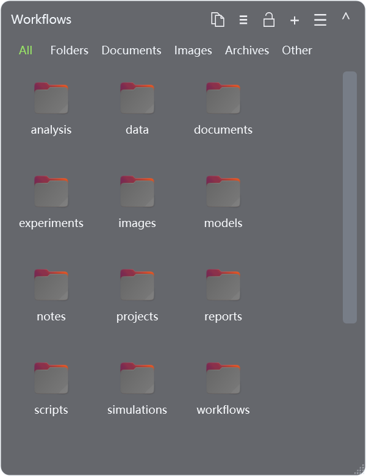

<p align="center"></p>
<h1 align="center">WSLBox</h1>
<p align="center"><strong>English</strong> · <a href="README.zh-CN.md">简体中文</a></p>
<p align="center">Linux folders on your Windows desktop.</p>
<p align="center"><a href="https://liunics.github.io/WSLBox/">Website</a> · <a href="https://github.com/liunics/WSLBox/releases">Download</a> · <a href="https://github.com/liunics/WSLBox/issues">Report an issue</a></p>

WSLBox displays WSL2 folders in transparent Windows desktop boxes. Browse Linux files, transfer them to and from Windows Explorer, and open them with their default Linux applications through WSLg.



## Download and run

Download **[WSLBox-v1.3.0.exe](https://github.com/liunics/WSLBox/releases/latest)** and double-click to run it.

Open **Folder settings**, choose a WSL distribution and the folder to display, and give the box a name.

## Requirements

- Windows 11, or Windows 10 build 19044 or later with WSLg support.
- A working WSL2 distribution and WSLg installation.
- Python 3, GIO / GTK 3 and D-Bus inside the Linux distribution.
- The Linux applications you want to use, with their default file associations configured.

For Ubuntu / Debian, install the dependencies in a Linux terminal:

```bash
sudo apt update
sudo apt install python3 python3-gi gir1.2-gtk-3.0 dbus libglib2.0-bin libgdk-pixbuf2.0-bin
```

Thumbnail support varies by file format. A Linux file manager such as PCManFM or Nautilus can restore files from Linux Trash.

[Microsoft WSLg setup guide](https://learn.microsoft.com/windows/wsl/tutorials/gui-apps)

## Features

- Multiple independent boxes with saved folders, positions and sizes.
- Adjustable background transparency, icon and list views, sorting, filtering and thumbnails.
- Lock, collapse, maximize and restore boxes; snap to screen edges and neighboring boxes.
- Optionally expand a collapsed box while the pointer is inside it and collapse again when it leaves.
- Double-click empty Windows desktop space to hide or show all boxes.
- Drag and drop, copy, cut and paste files between Windows and WSL.
- Open files with Linux default applications or choose another application with **Linux Open with**.
- Rename in place, create folders and move deleted files to Linux Trash.
- Windows file context menus with Linux actions grouped separately.
- Mouse back/forward navigation, keyboard shortcuts and copying Linux paths.
- Show hidden files per box, with a Ctrl+H shortcut.
- Optional start at Windows login.
- English, Simplified Chinese and system-language options.
- Project link, update checking and grouped shortcut tables in Help.

## Language

Choose **System**, **简体中文** or **English** from **Language / 语言** in the menu. Restart WSLBox to apply the preference to all boxes.

## Start at login

Enable **Start at login** in the tray or box menu to run WSLBox when you sign in to Windows. This option is off by default. Keep the EXE in a fixed location; turn the option off and on again after moving it.

## Common actions

| Action | Shortcut or gesture |
|---|---|
| Open a file / enter a directory | Double-click or Enter |
| Open the current directory in Windows Explorer | Double-click empty space inside a box |
| Copy the current Linux directory path | Header copy button |
| Return to the configured folder | Alt+Home |
| Back / forward | Mouse side buttons or Alt+Left / Right |
| Refresh | F5 or Ctrl+R |
| Rename | F2; Enter to confirm, Esc to cancel |
| Select all | Ctrl+A |
| New folder | Ctrl+Shift+N |
| New box | Ctrl+N |
| Move to Linux Trash | Delete |
| Permanently delete | Shift+Delete, with confirmation |
| Folder settings | Ctrl+L |
| Show or hide hidden files | Ctrl+H |

Dropping files into a box copies them by default; hold Shift to move. Open **Help and shortcuts** from the menu for the complete guide.

## Linux input methods

WSLBox supports Fcitx, Fcitx5 and IBus configured inside the selected Linux distribution. Install and configure your preferred input method there, then open applications from WSLBox. Restart WSLBox and the affected applications after changing the input-method configuration.

Some applications disable input methods internally and require application-specific handling.

## Compatibility and limitations

- Primarily tested on Windows 11 x64 with Ubuntu WSL2. Other distributions, ARM64 and Windows Server have not received the same validation.
- List view is recommended for very large directories.
- Cross-system file operations may not preserve all Linux permissions, extended attributes or special-file properties. Symlinks can be opened, but drag-out and cut have restrictions.
- Third-party context-menu features depend on the installed Windows applications.
- Permanent deletion requires confirmation. If Linux Trash is unavailable, files are preserved and an error is shown.
- Special handling for Win+D is not currently supported.

<details>
<summary>Troubleshooting: check runtime dependencies</summary>

If an application cannot start, open **Windows PowerShell** in the folder containing WSLBox and run:

```powershell
$report = Join-Path $env:TEMP "wslbox-check.json"
Start-Process ".\WSLBox-v1.3.0.exe" -ArgumentList @("--diagnose", "`"$report`"") -Wait
(Get-Content $report -Raw | ConvertFrom-Json).Checks | Format-Table Name, Ok, Required, Details -Wrap
```

</details>

## Source code and license

Application source is in [src/](src/). Source archives are available from [Releases](https://github.com/liunics/WSLBox/releases).

[Changelog](CHANGELOG.md) · [GNU GPL v3](LICENSE)
