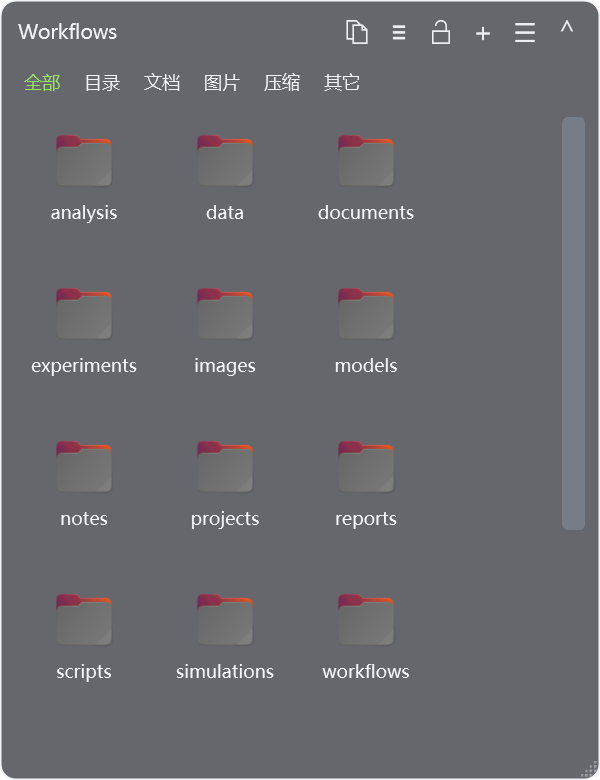

<p align="center"></p>
<h1 align="center">WSLBox</h1>
<p align="center"><a href="README.md">English</a> · <strong>简体中文</strong></p>
<p align="center">把 Linux 文件夹放到 Windows 桌面。</p>
<p align="center"><a href="https://liunics.github.io/WSLBox/">软件介绍</a> · <a href="https://github.com/liunics/WSLBox/releases">下载</a> · <a href="https://github.com/liunics/WSLBox/issues">问题反馈</a></p>

WSLBox 是专为 WSL2 文件夹设计的 Windows 桌面盒子。在透明格子中浏览 Linux 文件，与 Windows 资源管理器传输文件，并通过 WSLg 使用 Linux 默认应用程序打开文件。



## 下载与运行

下载 **[WSLBox-v1.2.0.exe](https://github.com/liunics/WSLBox/releases/latest)**，双击运行。

打开“文件夹设置”，选择 WSL 发行版和要展示的文件夹，并为格子设置名称。

## 环境要求

- Windows 11，或支持 WSLg 的 Windows 10 Build 19044 及以上版本。
- 已安装并可用的 WSL2 发行版和 WSLg。
- Linux 发行版中的 Python 3、GIO / GTK 3 和 D-Bus。
- 已安装要使用的 Linux 应用程序，并配置相应的默认文件关联。

Ubuntu / Debian 用户可在 Linux 终端安装依赖：

```bash
sudo apt update
sudo apt install python3 python3-gi gir1.2-gtk-3.0 dbus libglib2.0-bin libgdk-pixbuf2.0-bin
```

缩略图支持取决于文件格式。可通过 PCManFM、Nautilus 等 Linux 文件管理器恢复回收站中的文件。

[微软 WSLg 配置说明](https://learn.microsoft.com/windows/wsl/tutorials/gui-apps)

## 功能

- 多个独立格子，分别保存文件夹、位置和大小。
- 可调背景透明度、图标与列表视图、排序、筛选和缩略图。
- 锁定、收起、最大化及还原格子，支持屏幕贴边和格子之间吸附。
- 可选的悬停临时展开：移入展开，移出自动恢复收起。
- 双击 Windows 桌面空白处隐藏或显示全部格子。
- 在 Windows 与 WSL 之间拖放、复制、剪切和粘贴文件。
- 使用 Linux 默认应用程序打开文件，或通过“Linux 打开方式”选择其他应用。
- 原位重命名、新建文件夹，普通删除进入 Linux 回收站。
- 使用 Windows 文件右键菜单，并将 Linux 操作单独分组。
- 鼠标前进后退导航、键盘快捷键和 Linux 路径复制。
- 按格子设置是否显示隐藏文件，支持 Ctrl+H。
- 可选的 Windows 登录时启动。
- English、简体中文及跟随系统语言。
- 项目链接、检查更新，以及分组的帮助和快捷键表格。

## 界面语言

在菜单的 **Language / 语言** 中选择“跟随系统”、简体中文或 English。重新启动 WSLBox 后，对全部格子生效。

## 登录时启动

在托盘或格子菜单开启“登录时启动”，即可在登录 Windows 时自动运行 WSLBox。此选项默认关闭。请将 EXE 保存在固定位置；移动后，关闭并重新开启此选项。

## 常用操作

| 操作 | 方法 |
|---|---|
| 打开文件或进入目录 | 双击或 Enter |
| 在 Windows 资源管理器打开当前目录 | 双击格子内部空白处 |
| 复制当前 Linux 目录路径 | 顶栏复制按钮 |
| 返回设置的目录 | Alt+Home |
| 后退或前进 | 鼠标侧键或 Alt+←/→ |
| 刷新 | F5 或 Ctrl+R |
| 重命名 | F2，Enter 确认、Esc 取消 |
| 全选 | Ctrl+A |
| 新建文件夹 | Ctrl+Shift+N |
| 新建格子 | Ctrl+N |
| 移到 Linux 回收站 | Delete |
| 永久删除 | Shift+Delete，需确认 |
| 文件夹设置 | Ctrl+L |
| 显示或隐藏隐藏文件 | Ctrl+H |

拖入文件默认复制，按住 Shift 移动。完整操作说明可从菜单的“帮助和快捷键”查看。

## Linux 输入法

WSLBox 支持所选 Linux 发行版中已配置的 Fcitx、Fcitx5 和 IBus。在发行版内安装并配置所需输入法，再从 WSLBox 打开应用。修改输入法配置后，重新启动 WSLBox 和相关应用。

某些软件会在内部禁用输入法，仍需针对该软件单独处理。

## 兼容性与限制

- 主要验证环境是 Windows 11 x64 + Ubuntu WSL2，其他发行版、ARM64 和 Windows Server 尚未完成相同覆盖的验证。
- 文件特别多时建议使用列表视图。
- 跨系统文件操作可能无法完整保留 Linux 权限、扩展属性及特殊文件属性。符号链接支持打开，拖出和剪切存在限制。
- 右键菜单中的第三方功能取决于已安装的 Windows 应用程序。
- 永久删除需确认。Linux 回收站不可用时，保留文件并提示。
- 暂不支持针对 Win+D 的特殊处理。

<details>
<summary>故障排查：检查运行依赖</summary>

应用无法启动时，可在 WSLBox 所在文件夹打开 **Windows PowerShell**，运行：

```powershell
$report = Join-Path $env:TEMP "wslbox-check.json"
Start-Process ".\WSLBox-v1.2.0.exe" -ArgumentList @("--diagnose", "`"$report`"") -Wait
(Get-Content $report -Raw | ConvertFrom-Json).Checks | Format-Table Name, Ok, Required, Details -Wrap
```

</details>

## 源码与许可证

软件源码位于 [src/](src/)，源码包可从 [Releases](https://github.com/liunics/WSLBox/releases) 下载。

[更新记录](CHANGELOG.zh-CN.md) · [GNU GPL v3](LICENSE)
